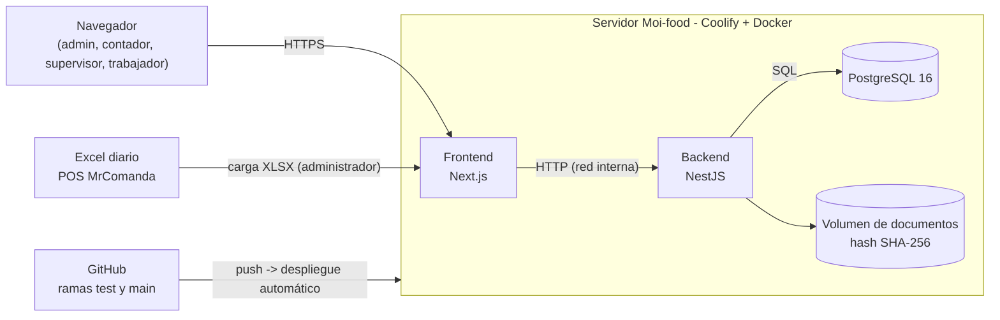

# Sistema de Gestión Interna Moi-food

Proyecto Capstone (PTY4614) de Ingeniería en Informática, Duoc UC Sede Melipilla. Equipo **Mosaico Dev**.

## Descripción

**Qué hace.** Es un sistema web de gestión interna que centraliza en un solo lugar la documentación laboral, el reparto de propinas, las ventas y diferencias de caja, y la toma de inventario. Cada acción queda registrada con su responsable y su fecha.

**A quién va dirigido.** Moi-food es un franquiciado de Subway con 3 locales: Santa María y Ugalde en Melipilla, y Calera. El sistema lo usan cuatro roles:

| Rol | Uso principal |
| --- | --- |
| Administrador (dueño) | Usuarios, locales, documentos, importación de ventas, pago de propinas e inventarios |
| Contador | Revisión de propinas, ventas y liquidaciones |
| Supervisor de turno | Operación diaria del local (propinas, voucher, diferencia de caja) y toma de inventario |
| Trabajador | Portal personal de solo lectura: liquidaciones, documentos y propinas |

**Qué problema resuelve.** Antes, la operación se llevaba en papel y de forma fragmentada:

- Los documentos laborales estaban escaneados, sin orden ni respaldo.
- El reparto de propinas se calculaba a mano y sin registro.
- Los descuadres de caja quedaban sin responsable ni motivo.
- El inventario se contaba en una hoja impresa.

Además, el negocio debe cumplir el Art. 9 bis del Código del Trabajo (conservar la documentación laboral 5 años), el Art. 64 (entregar las propinas pagadas con tarjeta en 7 días hábiles) y la Ley 21.719 de protección de datos personales. Con el sistema, el dueño puede tomar decisiones en base a los ingresos y egresos de cada local.

### Módulos

1. **Núcleo:** autenticación JWT, control de acceso por rol y por local, y auditoría de operaciones críticas.
2. **Gestor documental:** documentos por trabajador con hash SHA-256 y bloqueo de eliminación antes de 5 años. Las liquidaciones pasan de *pendiente de firma* a *publicada*, y hay alertas de plazos ante la Dirección del Trabajo.
3. **Propinas:**
   - Al guardar la operación diaria del supervisor, el fondo del día se reparte automáticamente en partes iguales.
   - El pago es por período, con un Excel de respaldo.
   - Las propinas impagas se alertan al vencer los 7 días hábiles.
4. **Ventas y caja:** importación del Excel diario del POS MrComanda, diferencias de efectivo con motivo, y panel y reportes por local.
5. **Inventario:**
   - Catálogo de productos con formato de caja y paquete.
   - Toma semanal del supervisor, que puede guardar y retomar.
   - Descarga en Excel con el formato de la plantilla del local.
6. **Portal del trabajador:** acceso de solo lectura, en el que cada trabajador ve únicamente su propia información.

## Tecnologías utilizadas

| Capa | Tecnología | Por qué |
| --- | --- | --- |
| Lenguaje | TypeScript | El tipado detecta errores antes de producción, lo que es crítico en montos de propinas y plazos legales. |
| Frontend | Next.js (React, App Router) + Tailwind CSS | Vistas por rol, usables en el celular del supervisor. |
| Backend | NestJS + Prisma | Un módulo por área del negocio, que calza 1 a 1 con el problema. |
| Base de datos | PostgreSQL 16 | Es libre y transaccional: la operación diaria y su reparto se guardan juntos o no se guardan. |
| Contenedores | Docker y Docker Compose | Mismo ambiente en desarrollo, pruebas y producción. |
| Despliegue | Coolify en el servidor de la empresa, con GitHub Actions | Despliegue automático, con $0 en hosting. |
| Pruebas | Vitest (unitarias e integración contra PostgreSQL real) y Playwright (end-to-end en móvil y escritorio) | |
| Gestión | Notion (Product Backlog, Sprint Backlog, tableros y DoD por sprint) y GitHub (una tarea, una rama, un pull request) | |

## Instrucciones de ejecución local

El código está en [`Fase 2/Evidencias Proyecto/Evidencias de sistema Aplicación`](Fase%202/Evidencias%20Proyecto/Evidencias%20de%20sistema%20Aplicaci%C3%B3n). Requiere Docker con Docker Compose v2 y Git. Node.js 24 solo hace falta para desarrollar sin Docker.

```bash
git clone https://github.com/Niklabs-dev/Captstone.git
cd "Captstone/Fase 2/Evidencias Proyecto/Evidencias de sistema Aplicación"
docker compose up --build
```

Compose levanta, en orden:

1. La base de datos PostgreSQL.
2. Las migraciones.
3. El seed: roles, tipos de documento, los 3 locales y el administrador inicial.
4. El backend.
5. El frontend.

Que `migrate` y `seed` terminen con código 0 es lo esperado.

| Qué | Dónde |
| --- | --- |
| Aplicación web | http://localhost:3000 |
| API | http://localhost:3001 |
| Documentación de la API (Swagger) | http://localhost:3001/api/docs |

Credenciales iniciales, solo para desarrollo: `admin@moi-food.cl` / `admin-cambiar-en-produccion`.

El [README de la aplicación](Fase%202/Evidencias%20Proyecto/Evidencias%20de%20sistema%20Aplicaci%C3%B3n/README.md) detalla:

- Las variables de entorno.
- El desarrollo sin Docker.
- Las pruebas.
- El respaldo de volúmenes.
- El despliegue con Coolify.

## Integrantes y roles

| Integrante | Rol Scrum | Rol técnico |
| --- | --- | --- |
| Nicolás Jiménez | Product Owner | Backend y base de datos |
| Luis Hernández | Scrum Master | Documentación y pruebas |
| Lucas Flores | Equipo de desarrollo | Frontend y Portal del Trabajador |

Dedicación: 13 horas semanales por integrante.

En el historial de Git, cada integrante aparece con estos nombres de autor:

| Integrante | Autor en los commits |
| --- | --- |
| Nicolás Jiménez | `nikblas` y `Nicolas Jimenez` (cuenta `Niklabs-dev`) |
| Luis Hernández | `gabriel` |
| Lucas Flores | `Lucas flores` y `Elmapache69` |

## Metodología de trabajo

Usamos **Scrum**, porque el alcance se fue ajustando con el cliente y con la retroalimentación del curso. Los sprints cortos nos permitieron mostrar avance real y cambiar de rumbo sin rehacer todo.

- **Artefactos:**
  - Product Backlog de historias de usuario, priorizado por riesgo legal.
  - Sprint Backlog, tablero de tareas y Definición de Terminado (DoD) por sprint, en Notion.
- **Eventos:**
  - Sprint Planning.
  - Daily Scrum.
  - Sprint Review con el cliente en el ambiente de pruebas.
  - Sprint Retrospective.
- **Regla de trabajo:** una tarea = una rama = un pull request revisado. Ninguna tarea pasa a *Hecho* sin lint, build, pruebas en el mismo PR y migraciones verificadas en una base limpia.

| Sprint | Duración | Entrega |
| --- | --- | --- |
| Sprint 1 | ~3 semanas | Usuarios, roles y auditoría |
| Sprint 2 | ~3 semanas | Documentos laborales y liquidaciones |
| Sprint 3 | 2 semanas | Registro y reparto de propinas |
| Sprint 4 | 1 semana | Operación diaria, ventas y caja (alcance refactorizado por retroalimentación) |
| Sprint 5 | 1 semana | Toma de inventario y descarga en Excel |

Los dos primeros sprints se extendieron por problemas de organización del equipo. Por eso, los dos últimos se planificaron de una semana.

## Arquitectura de la solución

Es un **monolito modular cliente-servidor de 3 capas**:

- Presentación en Next.js.
- API REST en NestJS, con un módulo por dominio de negocio.
- Datos en PostgreSQL, con un volumen separado para los archivos del gestor documental.

Descartamos microservicios porque, para un equipo de 3 y un semestre, solo sumaban complejidad. Cada módulo de NestJS se puede extraer después.



- Solo el frontend tiene dominio público. El navegador nunca llama directamente al backend.
- Hay dos ambientes en el mismo servidor, cada uno con su propia base de datos y su volumen de documentos:
  - **Pruebas:** rama `test`, en https://test.moifood.cl.
  - **Producción:** rama `main`.
- Como Coolify no carga el `docker-compose.yml` desde una ruta con espacios y tildes, un workflow de GitHub Actions publica la rama `deploy-test` con la carpeta de la aplicación en la raíz (`git subtree split`).

## Estructura del repositorio

```
Fase 1/   Definición del proyecto: acta, informe, EDT, RACI, Gantt, plan de comunicaciones, diagramas
Fase 2/
  Evidencias Grupales/      Guías e informe final, planillas
  Evidencias Individuales/  Diarios de reflexión por integrante
  Evidencias Proyecto/
    Evidencias de documentación/   Documentos del proyecto y artefactos Scrum
    Base de datos/                 Modelo de datos (MER) y esquema
    Evidencias de sistema Aplicación/   Código fuente (frontend, backend, Docker)
    Presentación Proyecto.pptx
Fase 3/   Presentación final y evidencias de cierre
```
